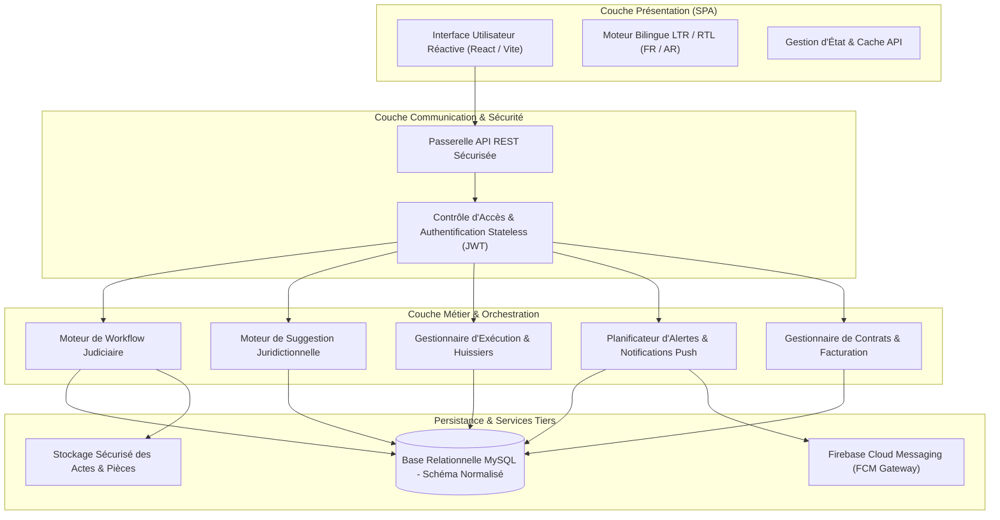

# ⚖️ CabinetAvocat — Système d'Information & Workflow Judiciaire

[-brightgreen.svg)](#internationalisation--ergonomie-juridique)

---

##  Présentation Générale

**CabinetAvocat** est une solution ERP et d'orchestration de contentieux conçue pour digitaliser l'ensemble de l'activité des cabinets d'avocats et des auxiliaires de justice.

Face à la complexité des procédures judiciaires (multiplicité des juridictions, rigidité des délais légaux, pluralité des intervenants et gestion bilingue des actes), la plateforme structure le cycle de vie complet des dossiers : de l'analyse préliminaire et l'assignation jusqu'à l'exécution forcée des décisions de justice.

### Proposition de Valeur
- **Modélisation procédurale automatisée** : Adaptation dynamique des étapes légales selon la nature du litige (Civil, Pénal, Commercial, Social, Administratif, Référé).
- **Routage juridictionnel intelligent** : Suggestion automatisée des tribunaux compétents (Tribunaux de Première Instance, Cours d'Appel, juridictions spécialisées) basée sur la classification légale de l'affaire.
- **Coordination multi-acteurs** : Gestion unifiée des relations entre le cabinet, les clients (demandeurs/opposants), les huissiers de justice, les experts assermentés et les témoins.
- **Zéro manquement de délai** : Système proactif de notifications push et d'alertes programmées en amont des audiences et des échéances critiques.

---

## 🏛️ Architecture Globale

Le système repose sur une architecture découplée orientée services, garantissant une séparation stricte entre la couche de présentation réactive et le moteur de règles métier transactionnel.

---

## ⚙️ Moteurs & Modules Métier

### 1. Moteur de Workflow Judiciaire & Machine à États
Le cœur du système repose sur un moteur dynamique régissant l'avancement d'un dossier à travers des phases séquentielles strictes :

- **Phase Pré-contentieuse / Initiale** : Mises en demeure, requêtes introductives, sommations interpellatives ou formalisation des plaintes.
- **Phase d'Instruction & Procédure** : Échanges de conclusions, comparution des parties, auditions de témoins, ordonnances d'expertise technique.
- **Phase de Jugement & Délibéré** : Suivi des prononcés, obtention des grosses et décisions exécutoires.
- **Voies de Recours** : Gestion des transitions en Appel ou pourvoi en Cassation avec réassignation juridictionnelle automatique.
- **Conditionnement contextuel** : Les étapes obligatoires, recommandées ou optionnelles s'ajustent automatiquement en fonction :
  - Du rôle juridique du client (Demandeur vs Défendeur / Opposant).
  - De la matière du dossier (Pénal, Civil, Commercial, Référé).

### 2. Moteur de Classification & Cartographie Juridictionnelle
- **Taxonomie juridique hiérarchique** : Système d'arborescence multiniveau (Types d'affaires principaux, sous-catégories et spécialisations).
- **Inférence de compétence** : Résolution algorithmique du type de tribunal compétent en fonction du code dossier et du niveau de juridiction requis.
- **Filtrage territorial** : Association automatique des tribunaux selon le ressort géographique et la compétence territoriale.

### 3. Orchestration de l'Exécution Forcée & Auxiliaires de Justice
Le recouvrement et l'application des décisions de justice constituent une phase critique couverte par des mécanismes dédiés :
- **Attribution d'huissiers de justice** : Assignation et suivi de la charge de travail des auxiliaires.
- **Traçabilité des actes d'exécution** : Mises en demeure, procès-verbaux de notification, constats, commandements et saisies.
- **Gestion des incidents d'exécution** : Suivi des recours et oppositions sur exécution.

### 4. Système d'Agenda et Notifications Push
- **Surveillance automatisée des échéances** : Tâche d'arrière-plan analysant continuellement les audiences et rendez-vous planifiés.
- **Alertes progressives** : Déclenchement automatique de rappels proactifs à `H-24` et `H-1`.
- **Routage de messages push** : Distribution ciblée vers les appareils enregistrés via jetons de périphériques sécurisés (Firebase Cloud Messaging).
- **Liens profonds (Deep Linking)** : Redirection contextuelle instantanée de l'utilisateur vers la fiche de l'audience ou de l'affaire concernée dès l'ouverture de la notification.

### 5. Gestion Électronique des Documents (GED) Judiciaire
- **Attachement granulaire** : Liaison des pièces probatoires, conclusions et jugements à l'affaire globale ou directement à une étape procédurale précise.
- **Conservation probatoire** : Centralisation des actes juridiques avec métadonnées associées (nature de la pièce, date d'enregistrement, auteur).

### 6. Module Financier & Facturation
- **Gestion contractuelle** : Établissement et suivi des conventions d'honoraires (forfait, temps passé, honoraire de résultat).
- **Cycle de facturation** : Émission, suivi des règlements, gestion des relances et calcul des soldes restant dus par affaire.

---

## 🛠️ Stack Technologique

| Couche | Technologie / Outil | Rôle Architectural |
| :--- | :--- | :--- |
| **Backend Core** | Python / Django REST Framework | API RESTful, moteur de règles métier, sérialisation et validation stricte |
| **Database** | MySQL | Persistance relationnelle conforme ACID, gestion de la forte intégrité référentielle |
| **Authentication** | JWT (JSON Web Tokens) | Authentification stateless, rotation de tokens d'accès et de rafraîchissement |
| **Push Gateway** | Firebase Cloud Messaging (FCM) | Distribution temps réel des notifications système sur terminaux mobiles/web |
| **Frontend Core** | React / Vite | Single Page Application (SPA) ultra-rapide avec compilation modulaire optimisée |
| **State & HTTP** | Axios / Intercepteurs personnalisés | Gestion des communications asynchrones, injection automatique des tokens d'autorisation |
| **Internationalisation** | i18next | Moteur de traduction dynamique avec prise en charge complète du rendu bi-directionnel |

---

## 🌐 Internationalisation & Ergonomie Juridique

Le secteur juridique exige une précision terminologique irréprochable et une adaptation aux systèmes bilingues :
- **Bilinguisme intégral (Français / Arabe)** : Traduction complète du lexique technique judiciaire (procédures, statuts, rôles des intervenants, types d'actes).
- **Gestion dynamique LTR / RTL** : Inversion automatique des grilles de mise en page, de la typographie et des flux de navigation selon la directionnalité de la langue sélectionnée.

---

## 🔒 Sécurité, Gouvernance & Secret Professionnel

En raison de la nature confidentielle des données traitées par les cabinets juridiques, la sécurité fait l'objet de mesures strictes :

- **Contrôle d'accès basé sur les rôles (RBAC)** : Isolation stricte des périmètres d'accès (Avocats associés, collaborateurs, juristes, personnel administratif, clients).
- **Secret professionnel & Cloisonnement** : Filtrage au niveau de la couche d'accès aux données garantissant qu'un tiers n'accède qu'aux dossiers où sa légitimité est formellement établie.
- **Intégrité transactionnelle** : Encapsulation des mutations critiques de workflow au sein de transactions atomiques pour prévenir toute incohérence d'état dans le cycle de vie judiciaire.
- **Protection des échanges** : Chiffrement des flux en transit (HTTPS/TLS) et assainissement strict des données en entrée contre les injections SQL et failles XSS.

---

## 📐 Spécification Conceptuelle des Domaines API

L'API expose un ensemble de ressources RESTful normalisées réparties par domaines d'autorité :
[Domaine Identité & Sécurité] ├── Session & Révocation de jetons └── Profils & Périphériques de notification (Device Tokens)

[Domaine Contentieux & Affaires] ├── Cycle de vie des affaires judiciaires ├── Progression, saut et validation d'étapes ├── Classification et suggestion d'affectation └── Gestion des pièces jointes et actes par dossier

[Domaine Auxiliaires & Parties Prenantes] ├── Répertoire des clients, opposants et avocats adverses ├── Interventions d'huissiers de justice (missions, procès-verbaux) └── Implication des experts judiciaires et dépositions de témoins

[Domaine Agenda & Planification] ├── Audiences, délibérés et rendez-vous └── Dispatcher d'alertes programmées

[Domaine Économique] ├── Conventions d'honoraires et contrats de prestation └── Émission et suivi des états de facturation

---
## 📄 Licence & Confidentialité
Ce référentiel présente l'architecture logicielle et les spécifications conceptuelles du système **CabinetAvocat**.  
Le code source propriétaire, les modèles de données sous-jacents et les algorithmes d'orchestration sont protégés par les lois en vigueur relatives à la propriété intellectuelle et au secret professionnel.
